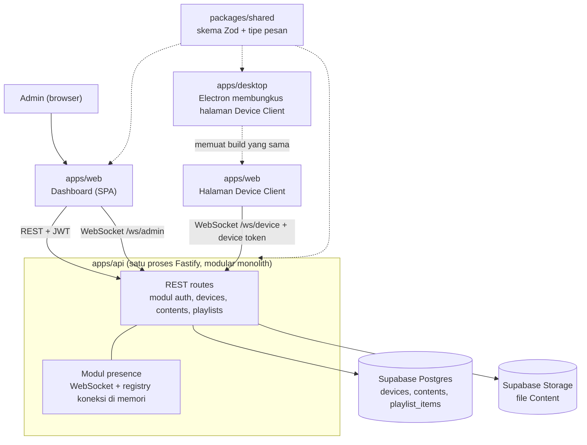
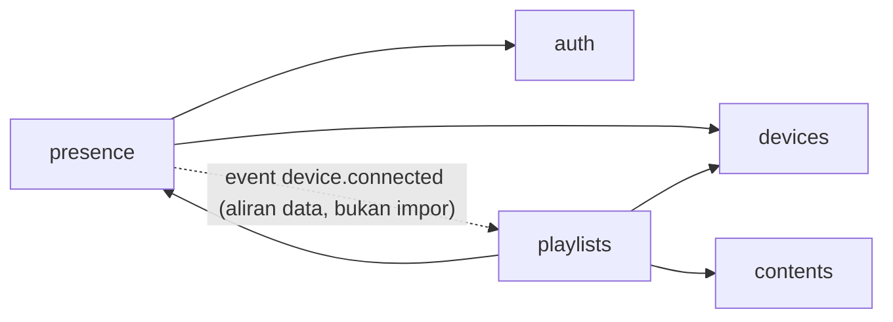
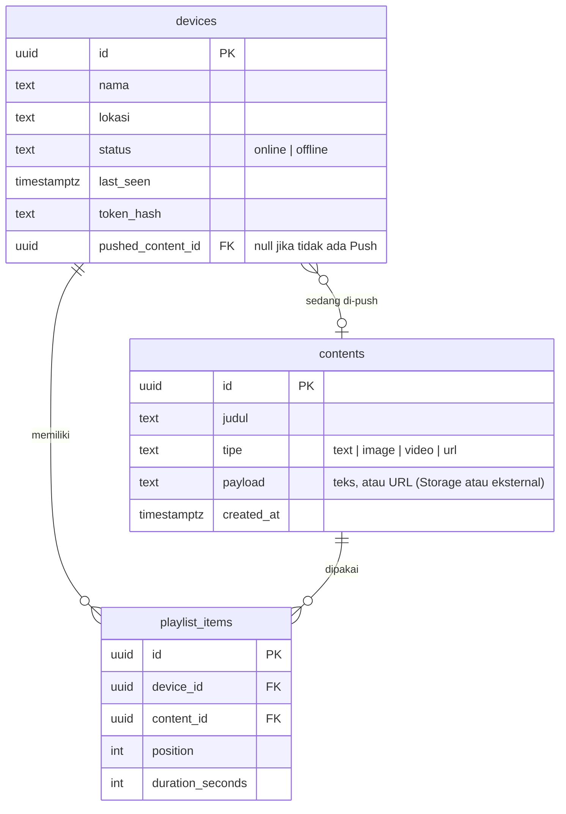
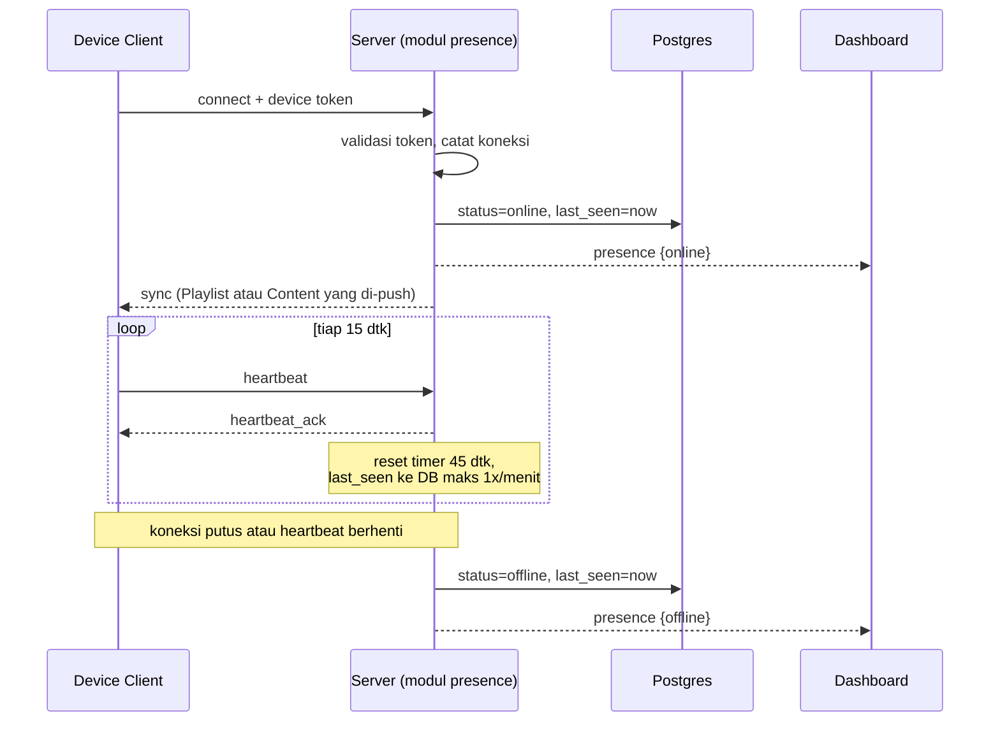

# Arsitektur Signage Control Panel

Dokumen ini menjelaskan bentuk sistem dan alasan umumnya. Istilah mengikuti [GLOSSARY.md](../GLOSSARY.md). Keputusan besar dicatat di [docs/adr/](./adr/).

## Kebutuhan

### Fungsional

- Admin mengelola Device dan Content lewat Dashboard (CRUD), termasuk upload atau attach Content.
- Presence (Online/Offline) tiap Device berubah di Dashboard secara realtime tanpa refresh.
- Device Client menampilkan Content.
- Bonus: Playlist per Device, Push dan Release, login Admin (JWT), reconnection Device Client, dan Device Client sebagai aplikasi Electron.

### Non-fungsional

| Aspek | Target |
| --- | --- |
| Deteksi Offline | Maksimal sekitar 1 menit dari koneksi mati diam-diam (heartbeat 15 dtk, timeout 45 dtk) |
| Pemulihan | Device Client menyambung ulang otomatis dan langsung menampilkan Content yang benar |
| Skala | Puluhan Device, satu instance server. Skala horizontal di luar cakupan (ADR-0002) |
| Keamanan | Service key Supabase hanya di server, semua endpoint butuh kredensial (ADR-0003, ADR-0006) |
| Kerapian | Kontrak pesan bertipe dan dipakai bersama (ADR-0001) |

### Batasan

- Waktu 4–5 hari kalender, satu pengembang.
- Database harus Supabase (Postgres).

## Gambaran sistem



## Struktur repo

```
/
├── apps/
│   ├── api/        Fastify: REST, WebSocket, akses Supabase (modular monolith)
│   ├── web/        React + Vite: Dashboard dan halaman Device Client
│   └── desktop/    Electron: membungkus halaman Device Client
└── packages/
    └── shared/     skema Zod, tipe pesan WebSocket, tipe entitas
```

## Struktur internal `apps/api`

Gayanya modular monolith (ADR-0008): satu proses, kode dibagi per domain, dan setiap modul berlapis di dalamnya.

```
apps/api/src/
├── main.ts                 composition root: merakit modul dan menyalakan server
├── platform/               hal lintas modul yang tidak punya aturan domain
│   ├── config.ts           baca dan validasi environment
│   ├── supabase.ts         satu-satunya tempat membuat klien Supabase
│   ├── events.ts           event bus di dalam proses
│   └── errors.ts           galat aplikasi dan pemetaannya ke HTTP
└── modules/
    ├── auth/               login Admin, penerbitan dan verifikasi JWT
    ├── devices/            tabel devices, device token, status tersimpan
    ├── contents/           tabel contents, upload ke Storage
    ├── playlists/          Playlist Item, Push dan Release, penyusunan pesan sync
    └── presence/           endpoint WebSocket, registry koneksi, heartbeat, siaran ke Dashboard
```

Isi tiap modul:

```
modules/devices/
├── index.ts          satu-satunya pintu masuk dari luar modul
├── devices.routes.ts      plugin Fastify: validasi Zod, panggil service
├── devices.service.ts     aturan bisnis
└── devices.repository.ts  satu-satunya yang berbicara ke tabel devices
```

### Tanggung jawab modul

| Modul | Memiliki | Menyediakan lewat `index.ts` |
| --- | --- | --- |
| `auth` | Kredensial Admin, JWT | `verifyAdminToken` |
| `devices` | Tabel `devices` (termasuk `token_hash` dan `pushed_content_id`) | `authenticateDevice`, `markOnline`, `markOffline`, `resetAllOffline`, `setPushedContent`, `getDevice` |
| `contents` | Tabel `contents`, file di Storage | `getContent`, pendaftaran pengaman hapus (lihat di bawah) |
| `playlists` | Tabel `playlist_items`, jalur REST Push dan Release | `buildSyncMessage` |
| `presence` | Registry koneksi, timer heartbeat, soket `/ws/device` dan `/ws/admin` | `sendToDevice`, `isOnline` |

### Aturan lapisan

- **Route** hanya memvalidasi input dengan skema `packages/shared`, memanggil service, dan memetakan hasil ke HTTP. Tidak ada aturan bisnis.
- **Service** memegang aturan bisnis dan tidak tahu tentang Fastify. Service menerima repository lewat konstruktor sehingga bisa diuji dengan repository palsu.
- Presence menerima fungsi verifikasi token Admin dan pelapor kegagalan yang sempit; adapter composition root/modul menghubungkannya ke JWT dan logger Fastify. `composition.ts` menyediakan satu jalur perakitan DevicesService yang dipakai `app.ts` dan `startup.ts`.
- **Repository** hanya membungkus akses Supabase dan mengembalikan tipe dari `packages/shared`. Tidak ada logika, dan tidak dibuat generik.
- Lapisan hanya boleh menunjuk ke bawah: route ke service ke repository. Repository tidak pernah diimpor dari luar modulnya.

### Aturan antar modul



Panah utuh berarti "mengimpor". Panah putus-putus adalah aliran event lewat `platform/events.ts` dan tidak menambah ketergantungan kode.

- Impor antar modul hanya boleh lewat `modules/<nama>/index.ts`, tidak boleh menembus ke `*.service.ts` atau `*.repository.ts` modul lain.
- Tidak boleh ada siklus. `auth`, `devices`, dan `contents` tidak bergantung pada modul lain.
- Dua tempat yang berpotensi membentuk siklus diselesaikan dengan event dan pengait, bukan dengan impor balik:
  - **Sync saat Device tersambung.** `presence` tidak mengimpor `playlists`. Ia menerbitkan event `device.connected` di `platform/events.ts`. `playlists` mendengarkan event itu, menyusun pesan `sync`, lalu memanggil `presence.sendToDevice`.
  - **Hapus Content yang masih dipakai.** `contents` tidak mengimpor `playlists`. `contents` menyediakan pengait pengaman hapus, dan `playlists` mendaftarkan dirinya di `main.ts`. Pengait itu menolak penghapusan Content yang masih ada di Playlist dan melepas Push bila Content itu sedang di-push.
- `main.ts` adalah satu-satunya tempat yang mengenal semua modul dan merakit ketergantungannya.

### Penegakan

Aturan di atas dicek otomatis dengan dependency-cruiser dan dijalankan di CI dan sebelum commit: larangan impor yang menembus `index.ts`, larangan siklus, dan larangan modul mengimpor `main.ts`. Aturan yang hanya berupa konvensi cenderung bocor seiring waktu.

## Teknologi

| Lapisan | Pilihan | Catatan |
| --- | --- | --- |
| Backend | Node.js, TypeScript, Fastify, modular monolith | ADR-0002, ADR-0008 |
| WebSocket | `ws` | protokol dan reconnection eksplisit |
| Database dan file | Supabase Postgres dan Storage, hanya lewat backend | ADR-0003 |
| Frontend | React, Vite, TanStack Router, Query, Table, Form | ADR-0004 |
| Validasi | Zod di `packages/shared` | satu sumber untuk REST dan WebSocket |
| Desktop | Electron memuat build SPA | tanpa server tambahan |
| Workspace | pnpm | ADR-0001 |

Library TanStack lain (Store, DB, Virtual, dan seterusnya) tidak dipakai kecuali ada kebutuhan nyata.

## Model data



Tabel `devices` dan `contents` mengikuti kolom yang diminta tes. `token_hash`, `pushed_content_id`, dan `playlist_items` adalah tambahan untuk bonus.

Catatan:

- `status` di database hanya cerminan terakhir. Sumber kebenaran Presence adalah registry koneksi di memori (ADR-0005).
- Menghapus Content yang masih dipakai Playlist ditolak (atau menghapus Playlist Item terkait dengan konfirmasi di Dashboard). Menghapus Content yang sedang di-push menjalankan Release otomatis.

## REST API

Semua endpoint di bawah `/api` dan butuh `Authorization: Bearer <JWT admin>`, kecuali login.

| Metode | Path | Fungsi |
| --- | --- | --- |
| POST | `/auth/login` | Tukar kredensial Admin dengan JWT |
| GET, POST | `/devices` | Daftar dan buat Device (respons buat memuat device token sekali tampil) |
| GET, PATCH, DELETE | `/devices/:id` | Baca, ubah, hapus Device |
| POST | `/devices/:id/token` | Rotasi device token |
| GET, PUT | `/devices/:id/playlist` | Baca dan ganti seluruh Playlist |
| POST | `/devices/:id/push` | Push satu Content: body `{ contentId }` |
| DELETE | `/devices/:id/push` | Release |
| GET, POST | `/contents` | Daftar dan buat Content (tipe teks atau URL) |
| POST | `/contents/upload` | Upload file ke Storage dan buat Content |
| GET, PATCH, DELETE | `/contents/:id` | Baca, ubah, hapus Content |

## Protokol WebSocket

Dua endpoint dengan peran berbeda. Semua pesan berupa JSON `{ type, ...data }` dan skemanya didefinisikan di `packages/shared`.

### `/ws/device` (Device Client)

Autentikasi: setelah WebSocket terbuka, pesan pertama harus `hello` berisi `deviceId` dan `token`. Token tidak dikirim melalui URL. Identitas/token tidak sah ditolak dengan close `1008`; satu socket hanya memproses satu handshake, termasuk selama autentikasi async.

Koneksi sah terbaru mengambil alih Device yang sama. Koneksi lama ditutup dengan kode aplikasi `4009` (`DEVICE_REPLACED_CLOSE_CODE` dari `packages/shared`), berbeda dari penolakan akses `1008` dan gangguan sementara `1011`. Urutan pembukaan socket menentukan koneksi terbaru meskipun autentikasi lama selesai belakangan.

Registry mengikat message, close, error, heartbeat, timeout, dan hasil async ke identitas koneksi. Hasil sync lama hanya boleh dikirim ke socket asal yang masih aktif. Penulisan Presence diurutkan per Device, diperiksa sebelum operasi dan sebelum siaran; penulisan yang sudah berjalan diselesaikan sebelum Presence pengganti ditulis, sehingga hasil akhirnya tetap mengikuti koneksi terbaru.

Setiap permintaan sync pada koneksi yang sama membatalkan hak kirim permintaan sebelumnya: hasil pembacaan Device, Content, atau Playlist yang selesai terlambat tidak boleh menimpa sync lebih baru. Koneksi baru hanya boleh mengirim sync dan menerima acknowledgment setelah penulisan Online berhasil. Kegagalan penulisan Online dilaporkan melalui fungsi pelapor, menutup socket dengan `1011`, dan membersihkan registry/timer agar retry dapat memulihkan Presence.

| Arah | Pesan | Isi |
| --- | --- | --- |
| Server ke Device | `sync` | Keadaan lengkap: Content yang di-push, atau Playlist. Dikirim saat tersambung dan tiap ada perubahan |
| Server ke Device | `push` / `release` | Perintah seketika |
| Device ke Server | `heartbeat` | Setiap 15 detik |
| Server ke Device | `heartbeat_ack` | `{ type: "heartbeat_ack" }`, hanya membalas heartbeat Device terautentikasi pada socket yang masih aktif |

`deviceServerMessageSchema` adalah discriminated union `sync` dan `heartbeat_ack`;
`heartbeatAckMessageSchema` menolak properti tambahan. Device Client memvalidasi pesan
sebelum menggunakannya. Setelah `sync` pertama pada setiap percobaan, `sync` atau
`heartbeat_ack` valid memperbarui watchdog 45 detik. Ack tidak mengubah tayangan,
posisi/durasi Playlist, status sinkronisasi, atau penghitung backoff. Pesan malformed
dan callback socket lama tidak memperpanjang watchdog. Timeout memakai jalur retry
berjitter yang sama dengan gangguan jaringan dan mempertahankan tayangan terakhir.
Heartbeat dan watchdog dibersihkan ketika percobaan berakhir, retry manual,
pergantian Device/token, atau unmount.

Setiap sync valid memberi identitas playback baru dan memulai Playlist dari item pertama. Setiap transisi Playlist juga memberi identitas playback baru, termasuk Content duplikat dan putaran Playlist satu item. Elemen media dipasang ulang sehingga video mulai dari awal walaupun URL sama. Ack, rerender biasa, dan gangguan sementara mempertahankan elemen media serta playback yang sedang berjalan.

### `/ws/admin` (Dashboard)

Autentikasi: JWT admin. Dashboard hanya menerima, tidak mengirim perintah lewat socket; perintah tetap lewat REST agar satu jalur otorisasi dan mudah diuji.

| Arah | Pesan | Isi |
| --- | --- | --- |
| Server ke Admin | `presence` | `{ deviceId, status, lastSeen }` saat berubah |
| Server ke Admin | `snapshot` | Presence semua Device saat tersambung |

## Alur utama

### Presence



### Push

1. Admin memanggil `POST /devices/:id/push` lewat REST.
2. Server menyimpan `pushed_content_id` lebih dulu, baru mengirim `push` ke Device bila sedang Online.
3. Bila Device Offline, perintah tidak hilang: saat tersambung ulang, `sync` membawa Content yang di-push.
4. `DELETE /devices/:id/push` mengosongkan kolom itu dan mengirim `release`.

### Reconnection Device Client

Saat koneksi putus, Device Client mencoba lagi dengan exponential backoff (1 dtk, 2, 4, 8, hingga 30 dtk, ditambah jitter) dan tetap menampilkan Content terakhir selama putus. Setelah tersambung ulang, ia menerima `sync` dan menyamakan tampilannya. Karena `sync` selalu berisi keadaan penuh, bukan selisih, tidak ada pesan yang perlu diputar ulang.

Keputusan desain tahap 6 berikut adalah target implementasi hasil pembahasan:

Tiket 01 menerapkan pemisahan tayangan dan koneksi, backoff berjitter, pemulihan manual,
penolakan token, serta isolasi percobaan di halaman Device Client. Harness frontend memakai
Vitest, jsdom, dan React Testing Library melalui `pnpm --filter @signage/web test`;
halaman dirender dengan WebSocket, waktu, dan jitter terkontrol tanpa Supabase nyata.
Tiket 02 menerapkan timeout connect dan sync pertama, masing-masing 15 detik:
open membatalkan timeout connect dan memulai timeout sync; hanya sync valid
membatalkan penantian sync. Timeout membersihkan percobaan lalu memakai backoff
yang sama, sambil mempertahankan Content/Playlist. Retry manual, pergantian
Device/token, dan unmount membersihkan kedua timeout; callback percobaan lama
diabaikan. Tes halaman mencakup batas waktu, keberhasilan sebelum batas,
pembatalan, callback usang, dan kelanjutan playback selama timeout/retry.
Tiket 03 menerapkan acknowledgment heartbeat dan watchdog halaman 45 detik.
Tiket 04 menerapkan pengambilalihan koneksi dengan close `4009`, penghentian terminal
dan pemulihan manual. Tiket 05 menerapkan reset Presence sebelum startup server
seperti dijelaskan di bawah.

- Batas backoff 1, 2, 4, 8, 16, lalu 30 detik; jeda dipilih acak antara 50–100% batas. Retry gangguan sementara tidak dibatasi jumlahnya. Penghitung di-reset setelah menerima `sync` valid, bukan saat socket terbuka.
- Pembukaan socket dan penantian `sync` pertama masing-masing dibatasi 15 detik. Heartbeat aplikasi tetap setiap 15 detik dan mendapat acknowledgment server melalui kontrak bersama; tidak ada `sync`/ack valid selama 45 detik memicu pemulihan koneksi.
- Selama gangguan sementara (termasuk close 1011), Content terakhir tetap tampil dan Playlist terus berputar. Indikator kecil menyediakan tombol Coba sekarang. Sebelum `sync` pertama, tampilkan Menghubungkan.
- Keadaan tayangan hanya dipertahankan di memori selama halaman terbuka. Tidak ada jaminan pemulihan setelah refresh offline atau caching media; gambar, video, dan URL tetap bergantung pada jaringan/cache browser.
- Penolakan identitas/token (1008) menghentikan retry dan tayangan, lalu menampilkan pesan serta tindakan Ganti token.
- Koneksi terbaru Device yang terautentikasi mengambil alih. Koneksi lama ditutup dengan `4009`, menghentikan tayangan/heartbeat/retry otomatis dan timer, lalu menampilkan Device digunakan di tempat lain serta Hubungkan kembali. Tombol itu memulai satu percobaan memakai token tersimpan; token diverifikasi ulang, dan penolakan `1008` masuk ke Ganti token. Callback socket lama tidak boleh memengaruhi registry/heartbeat socket baru. Tidak ada perebutan ulang otomatis antar halaman.
- Setiap `sync` baru menerapkan keadaan server terbaru dan memulai Playlist dari item pertama. Tombol retry manual, pergantian Device/token, dan unmount membersihkan percobaan lama sehingga hanya satu percobaan aktif.
- Sebelum listen pada startup satu instance, reset status tersimpan semua Device ke Offline tanpa mengubah Last Seen. Kegagalan reset menggagalkan startup. Device yang reconnect ditandai Online kembali.
  Jalur proses `main.ts` memanggil `startServer` di `startup.ts`: aplikasi dirakit, `devices.resetAllOffline` diselesaikan melalui repository devices, baru `listen` dijalankan. Kegagalan reset dicatat dengan konteks startup, aplikasi ditutup, dan proses berakhir gagal. Pembuatan aplikasi lewat `buildApp` untuk pengujian maupun reconnect tidak menjalankan reset. Tanpa konfigurasi database/layanan devices, tidak ada Presence tersimpan yang direset.
- Cakupan pemulihan tahap 6 adalah Device Client dan dukungan servernya; reconnect Dashboard tidak termasuk.

## Mode kegagalan

| Kegagalan | Dampak | Penanganan |
| --- | --- | --- |
| Koneksi Device putus diam-diam | Status Online salah | Timeout heartbeat 45 dtk menandai Offline |
| Server restart | Semua koneksi putus, memori hilang | Reset semua Device ke Offline saat start. Device Client menyambung ulang dan menerima `sync` |
| Supabase tidak terjangkau | CRUD gagal | REST mengembalikan 503. Presence di memori tetap jalan, penulisan `last_seen` dicoba lagi pada siklus berikutnya |
| Device Offline saat Push | Perintah tak terkirim | Push disimpan di database dan dikirim lewat `sync` saat tersambung |
| Token Device bocor | Pihak lain bisa meniru Device | Rotasi token dari Dashboard. Koneksi lama diputus |
| JWT Admin kedaluwarsa saat WebSocket terbuka | Dashboard berhenti menerima | Server menutup socket. Dashboard login ulang dan menyambung lagi |

## Keamanan

- Service role key dan `JWT_SECRET` hanya di environment `apps/api`.
- Password admin dari environment disimpan sebagai hash, dibandingkan dengan perbandingan waktu-konstan.
- Device token acak panjang, hanya hash-nya yang disimpan dan hanya tampil sekali.
- Semua input REST dan pesan WebSocket divalidasi dengan skema Zod bersama.
- Upload dibatasi tipe MIME dan ukuran.
- CORS dibatasi ke origin Dashboard.
- Payload bertipe teks dirender sebagai teks, bukan HTML, untuk mencegah XSS di layar Device.

## Risiko dan mitigasi

| Risiko | Mitigasi |
| --- | --- |
| Electron memakan waktu | Dikerjakan paling akhir. Halaman Device Client sudah berfungsi penuh di browser, Electron hanya pembungkus |
| Satu instance tidak bisa diskalakan | Diterima dan dicatat di ADR-0002. Jalur keluarnya adalah pub/sub (Redis) |
| Tipe pesan melenceng antar aplikasi | Skema Zod bersama di `packages/shared` |
| Cakupan bonus terlalu besar | Urutan kerja di bawah memastikan wajib selesai dulu |

## Urutan pengerjaan

Setiap tahap menghasilkan sesuatu yang bisa didemokan.

1. **Fondasi**: workspace, `packages/shared`, skema Supabase, Fastify jalan.
2. **Wajib, CRUD**: REST untuk Device dan Content, Dashboard dengan tabel dan form.
3. **Wajib, realtime**: modul `presence` (WebSocket, heartbeat), Presence tampil live di Dashboard, halaman Device Client menampilkan Content.
4. **Autentikasi**: JWT Admin, device token.
5. **Playlist dan Push**: `playlist_items`, `sync`, `push`, `release`, upload ke Storage.
6. **Reconnection**: backoff dan sinkronisasi ulang di Device Client.
7. **Electron**: pembungkus desktop.
8. **Poles**: UI/UX, README, dan petunjuk menjalankan.
